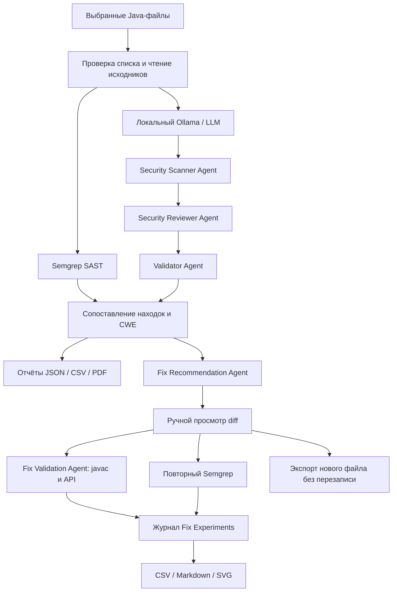

# Архитектура Code Security Analyzer (версия 9.0 RC)

## Права и ответственность

- **Пользователь** выбирает код для анализа, просматривает находки, подтверждает проведение функциональных тестов и принимает решение об использовании исправления.
- **LLM** предлагает оценку и черновик исправления, но не обладает правом изменять исходные файлы или выполнять предложенный код.
- **Semgrep** фиксирует срабатывания конкретного набора правил, но не подтверждает полноту проверки всех CWE.
- **Fix Validation** выполняет компиляцию без annotation processors во временной директории, но не гарантирует поведения и не является ОС-песочницей.
- **Fix Experiments** хранит результаты текущего сеанса в памяти; экспорт нужно выполнить до закрытия окна/приложения.
- **CI** выполняет Maven и Semgrep по production-коду без запуска Ollama. Создание архивов отчётов и JSON/SARIF не является сертификатом безопасности.
- **Release preflight** не выполняет исходники, LLM или сборку; проверяет только структуру проекта и сохранённые метаданные.

## Экспериментальная методика

1. Сохранять исходный кейс, метку CWE, исходную версию и предложенный вариант (отдельно от рабочего проекта).
2. Различать синтаксическую компиляцию, предварительную API-совместимость, повторный Semgrep и функциональные сценарии.
3. Ставить `SKIPPED` при технической невозможности проведения теста (например, создание символических ссылок в Windows), а не `PASSED`.
4. Для каждого CWE явно отмечать ограничения защитного механизма. Пример: `normalize()` — не проверка физического пути через символьные ссылки.
5. Экспортировать таблицу и диаграмму исключительно из реально записанных экспериментов; не смешивать попытки LLM с независимыми наборами данных.

**Ограничение:** репозиторий содержит пилотную искусственную выборку из 20 файлов (10 уязвимых и 10 условно безопасных). Любые количественные показатели нужно сопровождать условиями эксперимента и датой получения.
